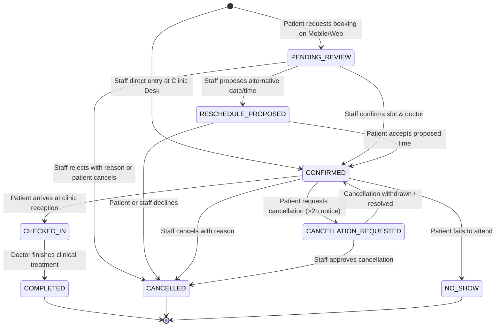

# REST API Guide & State Contracts
**Kumar Dental Clinic Platform**
**Base URL**: `/api/v1`

---

## 1. Role-Based Permissions & Record Authorization Matrix

| Domain & Operation | Endpoint | Patient | Receptionist | Dentist / Doctor | Administrator |
| :--- | :--- | :---: | :---: | :---: | :---: |
| **Auth: Patient Register / OTP** | `POST /auth/patient/register`, `POST /auth/otp/*` | Allowed | N/A | N/A | N/A |
| **Auth: Staff Login** | `POST /auth/staff/login` | Denied | Allowed | Allowed | Allowed |
| **Auth: Current Profile** | `GET /me`, `PATCH /me/profile` | Own only | Own only | Own only | Own only |
| **Services Directory** | `GET /services` | Read-only | Read-only | Read-only | Manage (CRUD) |
| **Doctor Availability** | `GET /availability` | Read-only | Read-only | Read & Edit Own | Manage |
| **Appointment: Book** | `POST /appointments` | Own (Starts PENDING) | For Any Patient | For Any Patient | For Any Patient |
| **Appointment: My Bookings** | `GET /appointments/me` | Own only | Denied | Denied | Denied |
| **Appointment: Admin List** | `GET /admin/appointments` | Denied | Allowed | Assigned Only / Filtered | Full Access |
| **Appointment: Status Transition** | `PATCH /appointments/{id}/status` | Cancel/Reschedule req only | Review / Confirm / Reschedule / Check-in | Complete / No-show | Full Control |
| **Patient Directory** | `GET /admin/patients`, `GET /admin/patients/{id}` | Denied | Read Demographics & Booking history | Read Demographics & Clinical Records | Read Demographics & Audit Clinical |
| **Clinical Treatment Records** | `POST /appointments/{id}/treatment-records`, `GET /treatment-records` | Read Own Finalized Summaries | **Denied** (Zero access to clinical notes) | Author & Edit (Own/Assigned) | Read with Audit Trail |
| **Prescriptions** | `POST /prescriptions`, `GET /prescriptions` | Read Own Finalized | **Denied** | Author & Sign | Read with Audit Trail |
| **Medical Documents** | `POST /patients/{id}/documents` | Upload Self-Reports | Upload Lab Reports | Upload X-Rays / Reports | Upload & Audit |
| **Document Download** | `GET /documents/{id}/download` | Read Own if `is_patient_visible=true` | Read Non-Clinical | Full Access | Full Access with Audit Log |
| **Follow-up Tasks** | `POST /appointments/{id}/follow-ups`, `GET /admin/follow-ups` | Denied (reads via notifications) | Manage & Mark Done | Author & Assign | Full Access |
| **Clinic Settings & Hours** | `GET /settings`, `PATCH /admin/settings` | Read-only | Read-only | Read-only | Full Access |
| **Audit Logs** | `GET /admin/audit-logs` | Denied | Denied | Denied | Allowed |

---

## 2. Appointment Lifecycle State Machine



### Permitted Status Transitions:
- `PENDING_REVIEW` -> `CONFIRMED`, `CANCELLED`, `RESCHEDULE_PROPOSED`
- `RESCHEDULE_PROPOSED` -> `CONFIRMED`, `CANCELLED`
- `CONFIRMED` -> `CHECKED_IN`, `CANCELLATION_REQUESTED`, `CANCELLED`, `NO_SHOW`
- `CANCELLATION_REQUESTED` -> `CANCELLED`, `CONFIRMED`
- `CHECKED_IN` -> `COMPLETED`, `CANCELLED`
- Server validates permissions for every status change:
  - Patients can only trigger transitions to `CANCELLATION_REQUESTED`, or accept `RESCHEDULE_PROPOSED`.
  - Receptionists/Admins can transition to `CONFIRMED`, `RESCHEDULE_PROPOSED`, `CANCELLED`, `CHECKED_IN`.
  - Doctors/Admins can transition `CHECKED_IN` to `COMPLETED` or `NO_SHOW`.

---

## 3. Core API Endpoints

### Authentication
- `POST /api/v1/auth/otp/request`: Request 6-digit OTP code to verified phone.
- `POST /api/v1/auth/otp/verify`: Verify phone OTP, issue JWT tokens (session).
- `POST /api/v1/auth/patient/register`: Complete patient name and profile upon initial phone verification.
- `POST /api/v1/auth/staff/login`: Staff login with institutional email and Argon2id password.
- `POST /api/v1/auth/refresh`: Refresh expired short-lived access token with refresh token.
- `POST /api/v1/auth/logout`: Revoke active refresh token.
- `GET /api/v1/me`: Retrieve current user identity and profile.
- `PATCH /api/v1/me/profile`: Update self-service profile fields.

### Services & Availability
- `GET /api/v1/services`: List active dental services, descriptions, categories.
- `GET /api/v1/availability?doctor_id={id}&date={YYYY-MM-DD}`: List available, booked, and blocked slots for a selected date and doctor, taking clinic hours and existing appointments into account.

### Appointments
- `GET /api/v1/appointments/me`: Patient fetches their own appointment list (upcoming & past).
- `POST /api/v1/appointments`: Submit booking request. Derives `patient_id` directly from authenticated token for patients. Starts in `PENDING_REVIEW`.
- `GET /api/v1/appointments/{id}`: Detailed appointment information (access-controlled).
- `PATCH /api/v1/appointments/{id}/status`: Transition appointment status with mandatory audit event.
- `POST /api/v1/appointments/{id}/cancel-request`: Patient requests cancellation with reason.
- `POST /api/v1/appointments/{id}/reschedule-request`: Patient submits reschedule request.

### Clinical Records & Prescriptions
- `POST /api/v1/appointments/{id}/treatment-records`: Authorized dentist records tooth number, clinical notes, treatment performed.
- `GET /api/v1/appointments/{id}/treatment-records`: Retrieve treatment record.
- `POST /api/v1/prescriptions`: Doctor creates prescription with medicine name, dosage, timing, duration.
- `GET /api/v1/patients/me/prescriptions`: Patient accesses approved prescriptions.
- `GET /api/v1/patients/{patient_id}/prescriptions`: Doctor/Admin accesses patient prescriptions.

### Medical Documents & X-Rays
- `POST /api/v1/patients/{patient_id}/documents`: Upload document metadata and binary to secure S3 storage.
- `GET /api/v1/patients/{patient_id}/documents`: List patient documents (filtered by visibility for patient callers).
- `GET /api/v1/documents/{document_id}/download-url`: Generates temporary presigned download URL (15-min TTL) after server authorization check.

### Clinic Administration
- `GET /api/v1/admin/dashboard`: Real-time operational metrics from database queries (today's counts, pending queue, upcoming follow-ups).
- `GET /api/v1/admin/appointments`: Paginated appointment list with date, doctor, status filters.
- `GET /api/v1/admin/patients`: Paginated patient search by name, phone, emergency contact.
- `POST /api/v1/admin/patients`: Register new patient on their behalf at front desk.
- `GET /api/v1/admin/audit-logs`: Security audit log viewer for admins.
- `GET /api/v1/admin/settings`: Retrieve clinic hours, booking rules, contact details.
- `PATCH /api/v1/admin/settings`: Update clinic configuration.

---

## 4. Error Handling & Standards

- **Standard Error Envelope**:
  ```json
  {
    "error": {
      "code": "SLOT_ALREADY_BOOKED",
      "message": "The selected appointment slot has already been reserved. Please select another slot.",
      "details": null
    }
  }
  ```
- No internal stack traces, database query strings, or credential details are leaked in error responses.
- Idempotency support: Clients can pass `Idempotency-Key` header on booking and notification triggers.
