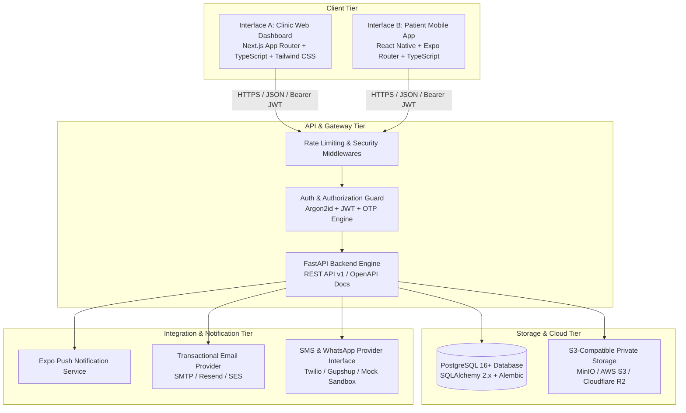

# System Architecture
**Kumar Dental Clinic Platform**

## 1. High-Level System Architecture

The platform consists of exactly two client applications connected to a single high-performance Python FastAPI backend and a shared PostgreSQL database.



---

## 2. Interface Specifications

### Interface A: Clinic Management Web Dashboard
- **Target Audience**: Clinic Administrator, Receptionist, Dentist / Doctor (All 3 roles inside the same dashboard, dynamically tailored based on verified backend token claims).
- **Technology**: Next.js (App Router), TypeScript, Tailwind CSS, TanStack Query (v5), React Hook Form, Zod.
- **Key Modules**:
  1. *Dashboard Overview*: Live KPIs from database (today's appointments, pending review requests, confirmed, completed, cancellations, follow-up alerts).
  2. *Appointment Desk*: Filterable appointment table, calendar/day/week views, booking approval/rejection modal, reschedule proposal drawer, status transition controller.
  3. *Patient Directory*: Searchable patient registry, demographic management, full patient clinical timeline, appointment history, document locker.
  4. *Doctor Workspace*: Clinical agenda, treatment record editor, tooth/quadrant selector, prescription authoring, private diagnostic report uploads (X-rays, OPGs, CBCTs), follow-up task creator.
  5. *Document Center*: Secure patient document uploader, MIME-type and size validator, presigned private download link generator with short TTL (15 minutes).
  6. *Operations & Settings*: Clinic schedule manager, doctor availability slots, booking buffer rules, staff invitations, notification provider toggles, auditable activity logs.

### Interface B: Patient Mobile Application
- **Target Audience**: Patients on Android & iOS devices.
- **Technology**: React Native, Expo (SDK 51+), Expo Router, TypeScript, React Hook Form, Zod, TanStack Query.
- **Key Modules**:
  1. *Authentication & Onboarding*: Phone OTP login/register, verified profile setup, privacy & consent acceptance.
  2. *Home Hub*: Personalized patient greeting, upcoming confirmed appointment countdown card, quick booking CTA, verified clinic contact and location actions.
  3. *Clinic Services Directory*: Verified services list fetched dynamically from backend (no app store update required for service changes).
  4. *Guided Booking Flow*: Service selection -> Doctor selection -> Server-validated availability slot grid -> Visit notes -> Confirmation screen -> Enters `PENDING_REVIEW` queue.
  5. *My Appointments*: Active and historical bookings, reschedule request trigger, cancellation request modal with reason.
  6. *My Health Records*: Secure access to published prescriptions, clinical treatment summaries, private X-ray viewing via short-lived signed URLs.
  7. *In-App Notifications*: History of booking confirmations, reminders, follow-up notifications.
  8. *Clinic Contact & Navigation*: Direct call action (`tel:`), WhatsApp chat trigger (`wa.me`), and Google Maps direction launcher.

---

## 3. Backend Architecture & Technology Stack

- **Runtime & Framework**: Python 3.12+ / 3.14, FastAPI, Starlette.
- **ORM & Data Layer**: SQLAlchemy 2.0 (modern 2.x declarative syntax), Alembic for version-controlled database migrations.
- **PostgreSQL Database**: Single normalized schema with UUID primary keys for records, foreign keys with referential integrity, indexes for fast slot queries, UTC timestamps.
- **Security & Cryptography**:
  - Staff password hashing: Argon2id (via `pwdlib` / `passlib[argon2]`).
  - Patient authentication: Phone number + cryptographic 6-digit OTP verification with strict expiration (5 minutes), attempt limits (3 max), and rate limiting.
  - Session tokens: Signed JWTs (HMAC-SHA256) with short access token TTL (15-60 min) and rotating refresh tokens.
  - Medical Document Protection: Zero public URLs; private S3-compatible bucket, backend verifies ownership and authorization before emitting short-lived signed URLs (15 min expiry).
- **Concurrency & Transaction Safety**:
  - Database row locking (`SELECT FOR UPDATE`) on appointment slot booking to eliminate race conditions and guarantee zero double-bookings.

---

## 4. Monorepo Structure

```text
kumar-dental-clinic/
├── apps/
│   ├── clinic-dashboard/        # Next.js App Router Web Dashboard
│   └── patient-mobile/          # Expo / React Native Patient Mobile App
├── backend/
│   ├── alembic/                 # Alembic migration scripts and env.py
│   ├── app/
│   │   ├── api/v1/              # API route controllers grouped by domain
│   │   │   ├── auth.py          # Staff & Patient authentication
│   │   │   ├── appointments.py  # Booking, status transitions, calendar
│   │   │   ├── patients.py      # Patient profiles, records, search
│   │   │   ├── clinical.py      # Treatment records, prescriptions
│   │   │   ├── documents.py     # Medical documents, upload, signed URLs
│   │   │   ├── services.py      # Clinic dental services & categories
│   │   │   ├── availability.py  # Doctor slots & schedule rules
│   │   │   ├── notifications.py # Notification dispatch & preferences
│   │   │   └── admin.py         # Clinic settings, staff, audit logs
│   │   ├── core/                # Config, security, database session, exceptions
│   │   ├── models/              # SQLAlchemy 2.0 DB models
│   │   ├── schemas/             # Pydantic v2 validation models
│   │   ├── services/            # Business logic (slots, auth, s3, notifications)
│   │   └── main.py              # FastAPI app factory, middleware, CORS
│   ├── tests/                   # Pytest automated test suite
│   ├── requirements.txt         # Python dependencies
│   ├── pyproject.toml           # Tooling & pytest config
│   └── Dockerfile               # Backend production container
├── infra/
│   ├── docker-compose.yml       # Local dev & staging container topology
│   └── nginx/                   # Reverse proxy configuration
├── docs/                        # Complete architectural and operational guides
│   ├── discovery-and-branding.md
│   ├── architecture.md
│   ├── database-schema.md
│   ├── api-guide.md
│   ├── security-and-privacy.md
│   ├── deployment.md
│   └── release-checklist.md
├── .github/workflows/           # CI pipelines (lint, test, build)
├── .gitignore
└── README.md
```
