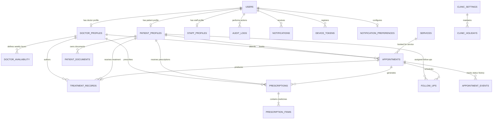

# Database Schema & Entity-Relationship Model
**Kumar Dental Clinic Platform**

## 1. Overview & Principles

- **Engine**: PostgreSQL 16+
- **Primary Keys**: UUID v4 for all business entities (eliminates ID enumeration attacks).
- **Timezone**: All timestamp columns are stored in UTC (`TIMESTAMP WITH TIME ZONE`). Conversion to Indian Standard Time (`Asia/Kolkata`, UTC+05:30) is performed for availability calculation and client display.
- **Data Isolation**: Authentication identity (`users`) is separated from domain profiles (`patient_profiles`, `doctor_profiles`, `staff_profiles`).
- **Auditability**: Sensitive medical records, status transitions, and administrative operations record `created_by_id`, `updated_by_id`, and generate immutable `audit_logs` and `appointment_events`.
- **Concurrency & Concurrency Control**: Slot reservations utilize row-level locking (`FOR UPDATE`) with a unique constraint on active bookings for `(doctor_id, appointment_date, start_time)` to strictly prevent double bookings.

---

## 2. Mermaid Entity-Relationship Diagram

---

## 3. Core Tables & Column Specifications

### A. Authentication & Identity
#### `users`
- `id`: UUID (Primary Key, default uuid_generate_v4())
- `email`: VARCHAR(255) (Nullable, Unique for staff accounts, Indexed)
- `phone`: VARCHAR(20) (Nullable, Unique for patient accounts, Indexed)
- `password_hash`: VARCHAR(255) (Nullable, Argon2id hash for staff; null for OTP-only patients)
- `role`: VARCHAR(30) NOT NULL (`PATIENT`, `RECEPTIONIST`, `DOCTOR`, `ADMIN`)
- `is_active`: BOOLEAN NOT NULL DEFAULT TRUE
- `is_verified`: BOOLEAN NOT NULL DEFAULT FALSE
- `created_at`: TIMESTAMPTZ NOT NULL DEFAULT NOW()
- `updated_at`: TIMESTAMPTZ NOT NULL DEFAULT NOW()

#### `otp_codes`
- `id`: UUID (Primary Key)
- `phone`: VARCHAR(20) NOT NULL (Indexed)
- `code_hash`: VARCHAR(255) NOT NULL (Hashed 6-digit OTP code)
- `purpose`: VARCHAR(30) NOT NULL (`LOGIN`, `REGISTER`, `RECOVERY`)
- `attempts`: INTEGER NOT NULL DEFAULT 0
- `expires_at`: TIMESTAMPTZ NOT NULL
- `consumed_at`: TIMESTAMPTZ (Nullable)
- `created_at`: TIMESTAMPTZ NOT NULL DEFAULT NOW()

#### `refresh_tokens`
- `id`: UUID (Primary Key)
- `user_id`: UUID NOT NULL REFERENCES `users(id)` ON DELETE CASCADE
- `token_hash`: VARCHAR(255) NOT NULL (Indexed)
- `revoked`: BOOLEAN NOT NULL DEFAULT FALSE
- `expires_at`: TIMESTAMPTZ NOT NULL
- `created_at`: TIMESTAMPTZ NOT NULL DEFAULT NOW()

---

### B. Profiles
#### `patient_profiles`
- `id`: UUID (Primary Key)
- `user_id`: UUID NOT NULL REFERENCES `users(id)` ON DELETE CASCADE (Unique)
- `first_name`: VARCHAR(100) NOT NULL
- `last_name`: VARCHAR(100) NOT NULL
- `date_of_birth`: DATE (Nullable)
- `gender`: VARCHAR(20) (Nullable)
- `blood_group`: VARCHAR(10) (Nullable)
- `emergency_contact_name`: VARCHAR(100) (Nullable)
- `emergency_contact_phone`: VARCHAR(20) (Nullable)
- `medical_history_notes`: TEXT (Nullable, encrypted or restricted)
- `allergies`: TEXT (Nullable)
- `address`: TEXT (Nullable)
- `city`: VARCHAR(100) DEFAULT 'Vadodara'
- `created_at`: TIMESTAMPTZ NOT NULL DEFAULT NOW()
- `updated_at`: TIMESTAMPTZ NOT NULL DEFAULT NOW()

#### `doctor_profiles`
- `id`: UUID (Primary Key)
- `user_id`: UUID NOT NULL REFERENCES `users(id)` ON DELETE CASCADE (Unique)
- `full_name`: VARCHAR(150) NOT NULL (e.g., 'Dr. Kumar M. Tipnis')
- `qualification`: VARCHAR(100) NOT NULL (e.g., 'BDS (Manipal)')
- `registration_number`: VARCHAR(50) (e.g., Dental Council of India registration)
- `specialization`: VARCHAR(150) NOT NULL
- `experience_years`: INTEGER NOT NULL DEFAULT 37
- `bio`: TEXT (Nullable)
- `is_active`: BOOLEAN NOT NULL DEFAULT TRUE
- `created_at`: TIMESTAMPTZ NOT NULL DEFAULT NOW()
- `updated_at`: TIMESTAMPTZ NOT NULL DEFAULT NOW()

#### `staff_profiles`
- `id`: UUID (Primary Key)
- `user_id`: UUID NOT NULL REFERENCES `users(id)` ON DELETE CASCADE (Unique)
- `first_name`: VARCHAR(100) NOT NULL
- `last_name`: VARCHAR(100) NOT NULL
- `department`: VARCHAR(100) NOT NULL DEFAULT 'Front Desk'
- `created_at`: TIMESTAMPTZ NOT NULL DEFAULT NOW()
- `updated_at`: TIMESTAMPTZ NOT NULL DEFAULT NOW()

---

### C. Services & Availability
#### `services`
- `id`: UUID (Primary Key)
- `name`: VARCHAR(150) NOT NULL (e.g., 'Root Canal Treatment')
- `slug`: VARCHAR(150) NOT NULL UNIQUE
- `category`: VARCHAR(100) NOT NULL (e.g., 'Endodontics', 'General', 'Cosmetic')
- `description`: TEXT NOT NULL
- `duration_minutes`: INTEGER NOT NULL DEFAULT 30
- `price`: NUMERIC(10, 2) (Nullable, for consultation pricing where approved)
- `is_active`: BOOLEAN NOT NULL DEFAULT TRUE
- `display_order`: INTEGER NOT NULL DEFAULT 0
- `created_at`: TIMESTAMPTZ NOT NULL DEFAULT NOW()
- `updated_at`: TIMESTAMPTZ NOT NULL DEFAULT NOW()

#### `doctor_availability`
- `id`: UUID (Primary Key)
- `doctor_id`: UUID NOT NULL REFERENCES `doctor_profiles(id)` ON DELETE CASCADE
- `day_of_week`: INTEGER NOT NULL (0 = Sunday, 1 = Monday, ..., 6 = Saturday)
- `start_time`: TIME NOT NULL (e.g., '10:00:00')
- `end_time`: TIME NOT NULL (e.g., '13:00:00')
- `slot_duration_minutes`: INTEGER NOT NULL DEFAULT 30
- `is_active`: BOOLEAN NOT NULL DEFAULT TRUE
- `created_at`: TIMESTAMPTZ NOT NULL DEFAULT NOW()

#### `clinic_holidays`
- `id`: UUID (Primary Key)
- `holiday_date`: DATE NOT NULL UNIQUE
- `reason`: VARCHAR(200) NOT NULL
- `created_at`: TIMESTAMPTZ NOT NULL DEFAULT NOW()

#### `clinic_settings`
- `id`: UUID (Primary Key)
- `clinic_name`: VARCHAR(200) NOT NULL DEFAULT 'Kumar Dental Clinic'
- `tagline`: VARCHAR(300)
- `phone_primary`: VARCHAR(20) NOT NULL DEFAULT '+91 98240 37497'
- `phone_secondary`: VARCHAR(20) DEFAULT '+91 95120 37497'
- `phone_landline`: VARCHAR(20) DEFAULT '+91 265 2314153'
- `email`: VARCHAR(100) DEFAULT 'contact@kumardentalclinic.com'
- `address`: TEXT NOT NULL
- `google_maps_url`: TEXT
- `booking_buffer_minutes`: INTEGER NOT NULL DEFAULT 15
- `max_advance_booking_days`: INTEGER NOT NULL DEFAULT 30
- `created_at`: TIMESTAMPTZ NOT NULL DEFAULT NOW()
- `updated_at`: TIMESTAMPTZ NOT NULL DEFAULT NOW()

---

### D. Appointments & Status Lifecycle
#### `appointments`
- `id`: UUID (Primary Key)
- `patient_id`: UUID NOT NULL REFERENCES `patient_profiles(id)` ON DELETE RESTRICT
- `doctor_id`: UUID NOT NULL REFERENCES `doctor_profiles(id)` ON DELETE RESTRICT
- `service_id`: UUID NOT NULL REFERENCES `services(id)` ON DELETE RESTRICT
- `appointment_date`: DATE NOT NULL (Indexed)
- `start_time`: TIME NOT NULL (Indexed)
- `end_time`: TIME NOT NULL
- `status`: VARCHAR(40) NOT NULL DEFAULT 'PENDING_REVIEW' (Indexed)
  - Values: `PENDING_REVIEW`, `CONFIRMED`, `RESCHEDULE_PROPOSED`, `CANCELLATION_REQUESTED`, `CANCELLED`, `CHECKED_IN`, `COMPLETED`, `NO_SHOW`
- `chief_complaint`: TEXT (Nullable, reason for visit)
- `rejection_reason`: TEXT (Nullable)
- `cancellation_reason`: TEXT (Nullable)
- `proposed_new_date`: DATE (Nullable)
- `proposed_new_time`: TIME (Nullable)
- `created_by_id`: UUID NOT NULL REFERENCES `users(id)`
- `updated_by_id`: UUID REFERENCES `users(id)`
- `created_at`: TIMESTAMPTZ NOT NULL DEFAULT NOW()
- `updated_at`: TIMESTAMPTZ NOT NULL DEFAULT NOW()
- **Constraint**: Unique constraint on `(doctor_id, appointment_date, start_time)` WHERE `status NOT IN ('CANCELLED', 'REJECTED')` to enforce zero double-booking at DB level.

#### `appointment_events`
- `id`: UUID (Primary Key)
- `appointment_id`: UUID NOT NULL REFERENCES `appointments(id)` ON DELETE CASCADE
- `from_status`: VARCHAR(40)
- `to_status`: VARCHAR(40) NOT NULL
- `changed_by_id`: UUID NOT NULL REFERENCES `users(id)`
- `notes`: TEXT (Nullable)
- `created_at`: TIMESTAMPTZ NOT NULL DEFAULT NOW()

---

### E. Clinical Records & Documents
#### `treatment_records`
- `id`: UUID (Primary Key)
- `appointment_id`: UUID NOT NULL REFERENCES `appointments(id)` ON DELETE RESTRICT
- `patient_id`: UUID NOT NULL REFERENCES `patient_profiles(id)` ON DELETE RESTRICT
- `doctor_id`: UUID NOT NULL REFERENCES `doctor_profiles(id)` ON DELETE RESTRICT
- `tooth_number`: VARCHAR(20) (Nullable, Universal or FDI tooth notation, e.g., '16', '21', 'Upper Right Quadrant')
- `clinical_notes`: TEXT NOT NULL
- `diagnosis`: TEXT NOT NULL
- `treatment_performed`: TEXT NOT NULL
- `follow_up_recommendation`: TEXT (Nullable)
- `created_at`: TIMESTAMPTZ NOT NULL DEFAULT NOW()
- `updated_at`: TIMESTAMPTZ NOT NULL DEFAULT NOW()

#### `prescriptions`
- `id`: UUID (Primary Key)
- `appointment_id`: UUID REFERENCES `appointments(id)` ON DELETE SET NULL
- `patient_id`: UUID NOT NULL REFERENCES `patient_profiles(id)` ON DELETE RESTRICT
- `doctor_id`: UUID NOT NULL REFERENCES `doctor_profiles(id)` ON DELETE RESTRICT
- `notes`: TEXT (Nullable)
- `follow_up_date`: DATE (Nullable)
- `is_finalized`: BOOLEAN NOT NULL DEFAULT TRUE
- `created_at`: TIMESTAMPTZ NOT NULL DEFAULT NOW()
- `updated_at`: TIMESTAMPTZ NOT NULL DEFAULT NOW()

#### `prescription_items`
- `id`: UUID (Primary Key)
- `prescription_id`: UUID NOT NULL REFERENCES `prescriptions(id)` ON DELETE CASCADE
- `medicine_name`: VARCHAR(200) NOT NULL (e.g., 'Amoxicillin 500mg')
- `dosage`: VARCHAR(100) NOT NULL (e.g., '1 tablet three times a day')
- `timing`: VARCHAR(100) NOT NULL (e.g., 'After food')
- `duration`: VARCHAR(100) NOT NULL (e.g., '5 days')
- `instructions`: TEXT (Nullable)

#### `patient_documents`
- `id`: UUID (Primary Key)
- `patient_id`: UUID NOT NULL REFERENCES `patient_profiles(id)` ON DELETE CASCADE
- `uploaded_by_id`: UUID NOT NULL REFERENCES `users(id)`
- `document_type`: VARCHAR(50) NOT NULL (`X_RAY`, `LAB_REPORT`, `PRESCRIPTION_SCAN`, `CLINICAL_PHOTO`, `OTHER`)
- `file_name`: VARCHAR(255) NOT NULL
- `s3_key`: VARCHAR(500) NOT NULL UNIQUE
- `mime_type`: VARCHAR(100) NOT NULL
- `file_size_bytes`: BIGINT NOT NULL
- `is_patient_visible`: BOOLEAN NOT NULL DEFAULT TRUE
- `quarantine_status`: VARCHAR(30) NOT NULL DEFAULT 'CLEAN' (`CLEAN`, `PENDING_SCAN`, `INFECTED`)
- `description`: TEXT (Nullable)
- `created_at`: TIMESTAMPTZ NOT NULL DEFAULT NOW()

---

### F. Follow-ups, Notifications & Auditing
#### `follow_ups`
- `id`: UUID (Primary Key)
- `patient_id`: UUID NOT NULL REFERENCES `patient_profiles(id)` ON DELETE CASCADE
- `assigned_to_id`: UUID REFERENCES `users(id)`
- `appointment_id`: UUID REFERENCES `appointments(id)` ON DELETE SET NULL
- `title`: VARCHAR(200) NOT NULL
- `notes`: TEXT (Nullable)
- `due_date`: DATE NOT NULL
- `status`: VARCHAR(30) NOT NULL DEFAULT 'PENDING' (`PENDING`, `IN_PROGRESS`, `COMPLETED`, `CANCELLED`)
- `completed_at`: TIMESTAMPTZ (Nullable)
- `created_at`: TIMESTAMPTZ NOT NULL DEFAULT NOW()

#### `notifications`
- `id`: UUID (Primary Key)
- `user_id`: UUID NOT NULL REFERENCES `users(id)` ON DELETE CASCADE
- `title`: VARCHAR(200) NOT NULL
- `body`: TEXT NOT NULL
- `channel`: VARCHAR(30) NOT NULL (`IN_APP`, `PUSH`, `EMAIL`, `SMS`, `WHATSAPP`)
- `delivery_status`: VARCHAR(30) NOT NULL DEFAULT 'PENDING' (`PENDING`, `SENT`, `FAILED`, `DELIVERED`)
- `idempotency_key`: VARCHAR(255) UNIQUE (Indexed)
- `read_at`: TIMESTAMPTZ (Nullable)
- `created_at`: TIMESTAMPTZ NOT NULL DEFAULT NOW()

#### `notification_preferences`
- `user_id`: UUID PRIMARY KEY REFERENCES `users(id)` ON DELETE CASCADE
- `push_enabled`: BOOLEAN NOT NULL DEFAULT TRUE
- `email_enabled`: BOOLEAN NOT NULL DEFAULT TRUE
- `sms_enabled`: BOOLEAN NOT NULL DEFAULT TRUE
- `whatsapp_enabled`: BOOLEAN NOT NULL DEFAULT TRUE
- `reminder_hours_before`: INTEGER NOT NULL DEFAULT 24

#### `device_tokens`
- `id`: UUID (Primary Key)
- `user_id`: UUID NOT NULL REFERENCES `users(id)` ON DELETE CASCADE
- `expo_push_token`: VARCHAR(255) NOT NULL
- `device_os`: VARCHAR(20) NOT NULL (`android`, `ios`, `web`)
- `updated_at`: TIMESTAMPTZ NOT NULL DEFAULT NOW()
- **Constraint**: Unique on `(user_id, expo_push_token)`

#### `audit_logs`
- `id`: UUID (Primary Key)
- `actor_id`: UUID REFERENCES `users(id)` ON DELETE SET NULL
- `action`: VARCHAR(100) NOT NULL (e.g., 'VIEW_PATIENT_RECORDS', 'APPROVE_APPOINTMENT', 'UPLOAD_XRAY')
- `target_type`: VARCHAR(50) NOT NULL (e.g., 'appointment', 'patient_document', 'treatment_record')
- `target_id`: UUID (Nullable)
- `ip_address`: VARCHAR(45) (Nullable)
- `user_agent`: TEXT (Nullable)
- `metadata_json`: JSONB (Nullable)
- `created_at`: TIMESTAMPTZ NOT NULL DEFAULT NOW()
