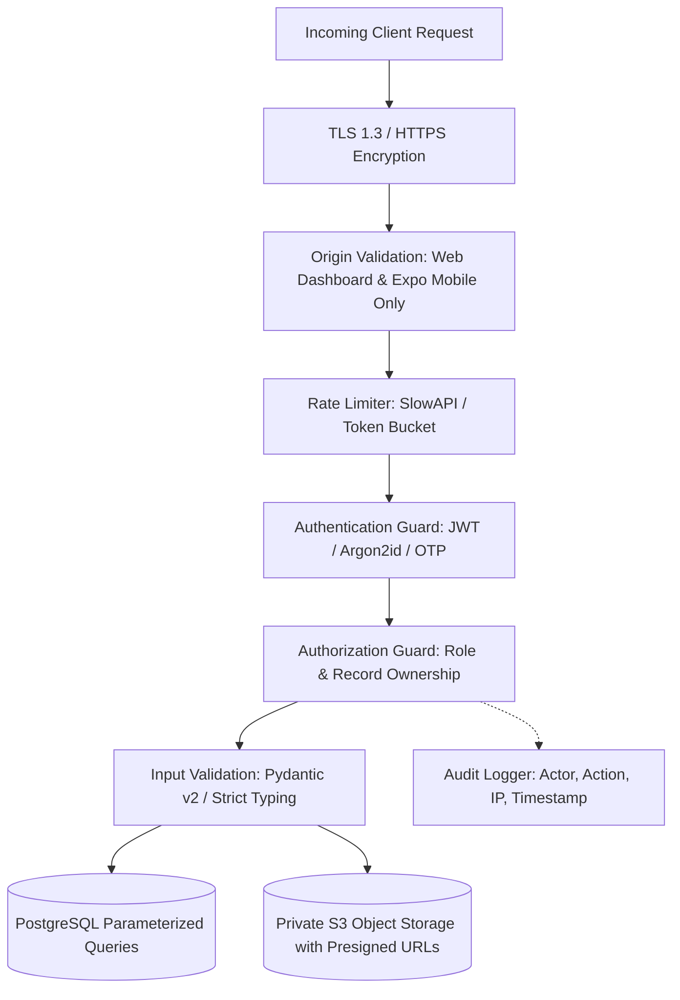

# Application Security & Privacy Architecture
**Kumar Dental Clinic Platform**

## 1. Security Architecture Principles

All patient records, medical documents, and diagnostic notes are treated as Sensitive Personal Data.

---

## 2. Authentication & Credential Security

1. **Staff Email & Password Authentication**:
   - Modern password hashing using **Argon2id** (`argon2_cffi`).
   - Minimum password length: 10 characters with upper, lower, digit, and symbol.
   - Brute-force protection: Rate limit to 5 failed attempts per 15 minutes before temporary lockout.
   - Session revocation: Token revocation via refresh token invalidation in database.

2. **Patient Phone OTP Authentication**:
   - Phone format normalized to E.164 standard (`+91XXXXXXXXXX`).
   - OTP codes are 6 digits, cryptographically random (`secrets.randbelow`).
   - Stored in database as a secure hash (`code_hash`), never plaintext.
   - Expiration window: 5 minutes.
   - Max verification attempts: 3 attempts per code before invalidation.
   - **Environment Guard**: Development mock OTP mode is strictly gated behind `ENVIRONMENT=development`. In production (`ENVIRONMENT=production`), development mock fails closed and throws a critical configuration error if enabled without real SMS provider credentials.

3. **Session & JWT Security**:
   - Access tokens have short TTL (60 minutes).
   - Refresh tokens stored securely with cryptographic hash and expiry in database.
   - On the web dashboard, tokens can be stored in HTTP-only, SameSite=Lax, Secure cookies or secure auth headers.
   - On the patient mobile app, stored using `expo-secure-store` (Keychain on iOS, EncryptedSharedPreferences on Android).

---

## 3. Role & Record-Level Authorization (Zero-Trust Model)

- **Never trust client-supplied IDs**: In patient-facing requests (e.g., `POST /appointments`, `GET /appointments/me`), the user's `patient_id` is derived strictly from the verified JWT claims, not from URL parameters or request bodies.
- **Strict Role Boundaries**:
  - `PATIENT`: Access strictly restricted to records where `patient_id == token.patient_id`.
  - `RECEPTIONIST`: Operational front-desk management. Can view appointments, patient demographics, and contact details. **Strictly barred** from viewing clinical diagnoses, treatment notes, prescriptions, and private doctor notes.
  - `DOCTOR`: Clinical access to assigned patients, authoring treatment records and prescriptions, viewing diagnostic X-rays.
  - `ADMIN`: Operational oversight, staff management, audit log inspection, clinic settings. Direct clinical record viewing is explicitly logged in `audit_logs`.

---

## 4. Medical Document Security & Private Storage

- **Zero Public Bucket Access**: Document storage buckets are configured as strictly private.
- **Presigned URLs Only**: Clients never get direct read or write access. When a patient or clinician requests to view an X-ray or report, the backend validates authorization and issues a short-lived (15 minutes) HMAC-signed URL.
- **MIME & Magic Byte Validation**: Uploaded files are validated for both declared MIME type and file signature (magic bytes) to prevent executable disguising (e.g., `.exe` renamed to `.jpg`).
- **File Types Allowed**: `image/jpeg`, `image/png`, `image/webp`, `application/pdf`, `image/tiff` (common for dental radiography). Max size: 25MB per document.

---

## 5. Indian Healthcare & Privacy Compliance (DPDP Act)

The platform is designed in accordance with India's **Digital Personal Data Protection (DPDP) Act** and applicable medical council standards:

1. **Notice & Explicit Consent**:
   - During patient mobile onboarding, patients are presented with a clear privacy notice in simple language outlining what data is collected (Name, Phone, Medical history, Dental X-rays) and its clinical purpose.
   - Explicit consent checkbox is logged with a timestamp in `users.is_verified`.
2. **Purpose Limitation**:
   - Patient contact numbers and health records are used solely for appointment coordination, clinical treatment, and healthcare follow-ups.
3. **Data Principal Rights**:
   - *Right to Access*: Patients can view all their past appointments, authorized medical documents, and prescriptions via the mobile app.
   - *Right to Correction*: Patients can update demographic details in profile settings.
   - *Right to Deactivation*: Patients can request account deactivation. Historical clinical and financial records are retained in compliance with clinical record retention guidelines (Indian Dental Council recommends maintaining clinical records for a minimum of 3 years), but patient account access is deactivated.
4. **Audit Logging**:
   - Access to sensitive patient clinical files generates an immutable record in `audit_logs` storing `actor_id`, `action`, `target_id`, `ip_address`, and `created_at`.
